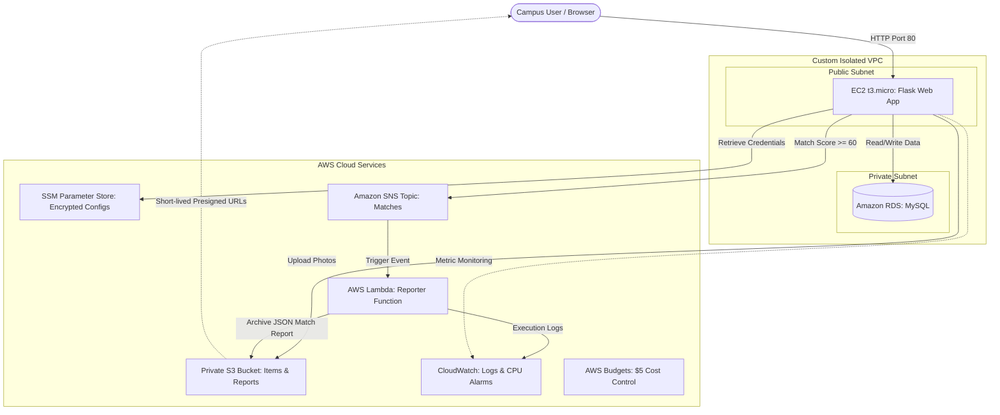

# CampusLost&Found

> A cloud-native web application and automated matching platform designed for university campuses to help students and staff report, track, and recover lost or found items.

[](https://www.python.org/)
[](https://flask.palletsprojects.com/)
[](https://aws.amazon.com/)
[](https://www.mysql.com/)

---

## Architecture Overview



---

## 10-Point AWS Cloud Architecture Mapping

This project maps directly to standard cloud architecture evaluation rubrics:

| # | AWS Service | Architectural Role in CampusLost&Found | Rubric Area |
|:---:|:---|:---|:---|
| **1** | **Amazon EC2 (`t3.micro`)** | Hosts the web application, user session handling, posting, and the matching engine. | **Compute** |
| **2** | **VPC & Subnets** | Custom isolated network. Public subnets host the web server; private subnets isolate RDS MySQL. Security groups restrict DB access exclusively to the EC2 instance (`web-sg` &rarr; `db-sg`). | **Networking** |
| **3** | **Amazon RDS MySQL** | Managed relational database hosting normalized `users`, `items`, and `matches` tables. | **Database** |
| **4** | **Amazon S3** | Secure object storage. Stores item photos in private `items/` prefix (served via 10-minute presigned URLs) and stores Lambda JSON match archives in `match-reports/`. | **Storage** |
| **5** | **AWS IAM** | Least-privilege IAM roles for EC2 and Lambda. Neither application nor infrastructure code contains hardcoded credentials. | **Security** |
| **6** | **SSM Parameter Store** | Securely stores database host, credentials, S3 bucket names, topic ARNs, and Flask secret key as encrypted parameters (`/lostfound/*`). | **Security** |
| **7** | **Amazon SNS** | The `lostfound-matches` topic broadcasts match alerts and triggers Lambda. The `lostfound-alarms` topic distributes operational CloudWatch alerts. | **Extra Capability** |
| **8** | **AWS Lambda** | Event-driven function triggered on match notifications to persist a timestamped JSON audit report to S3. | **Extra Capability** |
| **9** | **Amazon CloudWatch** | Aggregates execution logs from Lambda and runs an alarm (`lostfound-high-cpu`) monitoring EC2 CPU utilization. | **Monitoring** |
| **10** | **AWS Budgets** | Enforces a strict \$5/month cost budget with automated email notifications when actual spend exceeds 80%. | **Governance** |

---

## Intelligent Heuristic Matching Engine

When a new item is posted, the backend immediately compares it against all active opposite-type reports (Lost vs. Found) using a 100-point scoring model:

$$\text{Total Score} = \text{Category} + \text{Location} + \text{Date Proximity} + \text{Title Overlap}$$

- **Category Match (+40 pts):** Item categories match exactly.
- **Location Match (+25 pts):** Normalized, case-insensitive campus location match.
- **Date Proximity (+15 pts):** Incident dates within $\le 3$ days of each other.
- **Title Keyword Overlap (+5 pts each, max +20 pts):** Common descriptive tokens matching across titles.

**Threshold:** Any pair scoring $\ge 60$ points automatically logs a match, records it in the database, and publishes an SNS notification.

---

## Repository Structure

```text
CampusLostFound/
├── app.py                # Main Flask web application, routing, matching logic
├── lambda_function.py    # AWS Lambda SNS event consumer & S3 report writer
├── .gitignore            # Git exclusion rules (protects credentials and keys)
├── README.md             # Complete system documentation
└── requirements.txt      # Python dependencies
```

---

## Getting Started

### Prerequisites
- Python 3.9+
- An AWS Account with IAM, EC2, RDS MySQL, S3, SNS, SSM, and Lambda configured

### 1. Local Development Setup
Clone the repository and install dependencies:
```bash
git clone https://github.com/your-username/CampusLostFound.git
cd CampusLostFound
pip install -r requirements.txt
```

Set environment variables for local testing (optional, defaults to local demo values):
```bash
export LOSTFOUND_DB_HOST="localhost"
export LOSTFOUND_DB_USER="root"
export LOSTFOUND_DB_PASS="password"
export LOSTFOUND_DB_NAME="lostfound"
export LOSTFOUND_BUCKET="lostfound-bucket"
export LOSTFOUND_TOPIC_ARN="arn:aws:sns:region:account:lostfound-matches"
export LOSTFOUND_SECRET_KEY="local-dev-secret-key"
```

Start the application:
```bash
python app.py
```
Visit `http://localhost:80` (or `http://localhost:5000`) in your browser.

### 2. Production Deployment (EC2)
On your Amazon Linux / Ubuntu EC2 instance:
```bash
# Install dependencies
pip install -r requirements.txt

# Run with Gunicorn (Production WSGI)
gunicorn -w 2 -b 0.0.0.0:80 app:app
```

---

## Live Presentation / Demo Script

1. **Sign In / Registration:** Register a new user or log in with roll number and college email.
2. **Post a Lost Item:** Submit a report:
   - *Title:* "Blue Stainless Steel Water Bottle"
   - *Category:* "Bottle"
   - *Location:* "Library"
   - *Date:* Today's date
3. **Post a Found Item:** Submit a matching report from another account:
   - *Title:* "Blue Steel Water Bottle found near entrance"
   - *Category:* "Bottle"
   - *Location:* "Library"
   - *Date:* Today's date
4. **Showcase the Match:**
   - Navigate to the `/my` dashboard to show the automated **Match Score (65%+)**.
   - Show the Lambda CloudWatch log output and S3 `match-reports/` entry proving the end-to-end event-driven architecture.

